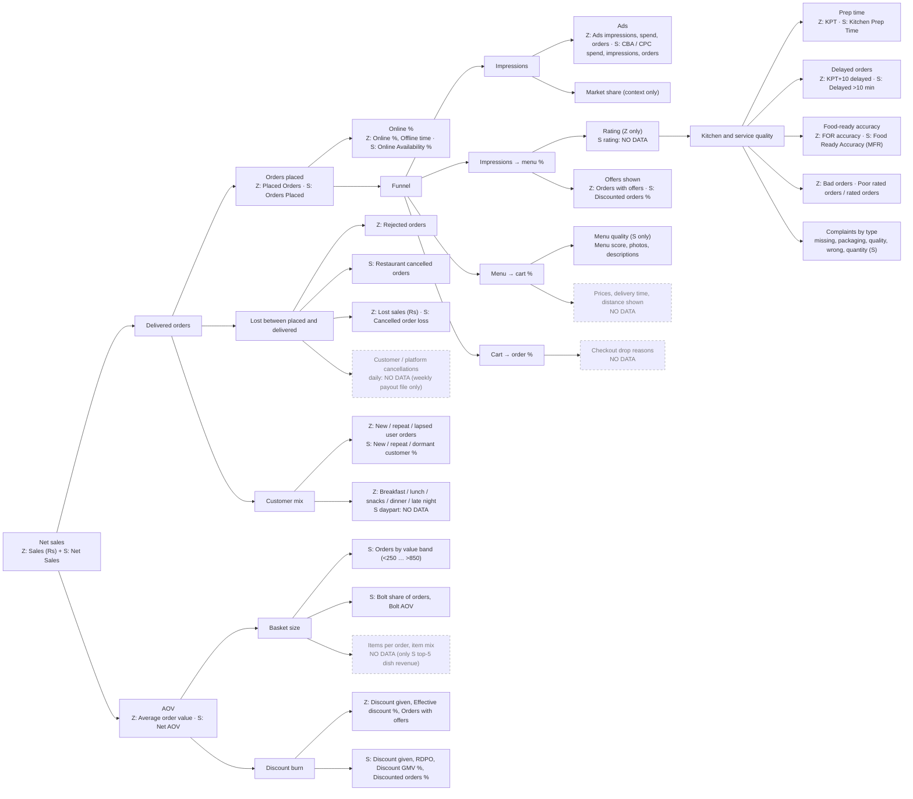

# Root-cause tree: starter draft for Raghav to correct

**Status: a draft to start from.** Raghav, please redraw, re-order or cut freely. It uses only metrics we actually get (see `METRICS-BY-PLATFORM.md`). Branches marked **NO DATA** are places where we have nothing today.
Written 15 Nov 2026 (IST).

How it's meant to be used: when the top number is down, check the branches below it in order and stop at the first one that moved by a lot. The order shown is our guess; the right order is the main thing we need from you.

## Flowchart

(A picture of the same chart: `METRIC-TREE-DRAFT.png`.)

## The same tree as a plain list

1. **Net sales** (Zomato "Sales (Rs)" + Swiggy "Net Sales") = **delivered orders × AOV**
   1. **Delivered orders**
      1. **Orders placed** (Z Placed Orders, S Orders Placed)
         - **Online %**: Z Online %, Z Offline time (hours), S Online Availability %. *Our guess: check this first; being offline is the most common single cause.*
         - **Funnel**: impressions → impressions-to-menu % → menu opens → menu-to-cart % → cart builds → cart-to-order % → orders placed.
           - Impressions are driven by:
             - ads: Z ads impressions, spend, ad orders, ROI; S CBA and CPC spend, impressions, menu visits, orders, ROAS;
             - market share (context only).
           - Impressions → menu is driven by:
             - rating (Zomato only; **Swiggy rating: NO DATA**);
             - offers shown (Z orders with offers; S discounted orders %).
           - Menu → cart is driven by:
             - menu quality (Swiggy menu score, photos, descriptions);
             - **prices, delivery time and distance shown: NO DATA**.
           - Cart → order: **checkout drop reasons: NO DATA**.
      2. **Lost between placed and delivered**
         - Z rejected orders; S restaurant-cancelled orders.
         - Z lost sales (₹); S cancelled-order loss (₹).
         - Customer or platform cancellations: **no daily data** (weekly payout file only).
      3. **Customer mix** (who is ordering)
         - Z new, repeat and lapsed user orders; S new, repeat and dormant customer %.
         - Z daypart orders (breakfast, lunch, snacks, dinner, late night). **Swiggy daypart: NO DATA**.
   2. **AOV** (Z Average order value; S Net AOV, after discounts)
      1. **Basket size**
         - S orders by value band (below ₹250, 250–450, 450–650, 650–850, above ₹850).
         - S Bolt share and Bolt AOV.
         - **Items per order and item mix: NO DATA** (only Swiggy's top-5 dish revenue).
      2. **Discount burn**
         - Z discount given, effective discount %, orders with offers.
         - S discount given, RDPO (discount per order), discount GMV %, discounted orders %.
2. **Quality loop.** It doesn't move today's sales directly; it moves rating, and so future impressions and conversion.
   - Prep time: Z KPT, S Kitchen Prep Time.
   - Delayed orders: Z KPT+10, S >10 min.
   - Food-ready accuracy: Z FOR accuracy, S MFR.
   - Zomato bad orders, and poor-rated vs rated orders.
   - Complaints by type: missing, packaging, quality, wrong, and quantity (Swiggy).
3. **Side branch: money after sales** (weekly, from payouts; for the Thursday payout check, not the daily tree).
   - Gross sales → − restaurant discount → commissionable value → − commission, other fees, GST on fees, ads → net payout → compared with the amount paid to the bank.

## Questions this draft leaves for Raghav

- In what order should we check the branches when sales drop? Online % first, then funnel, then leakage, then AOV?
- Should rating, menu quality and offers sit under the funnel step they mainly affect (as drawn), or form their own branch?
- Is the quality loop worth a daily alert of its own, or only as a reason when orders drop?
- Anything missing that you look at in the partner apps every day?
